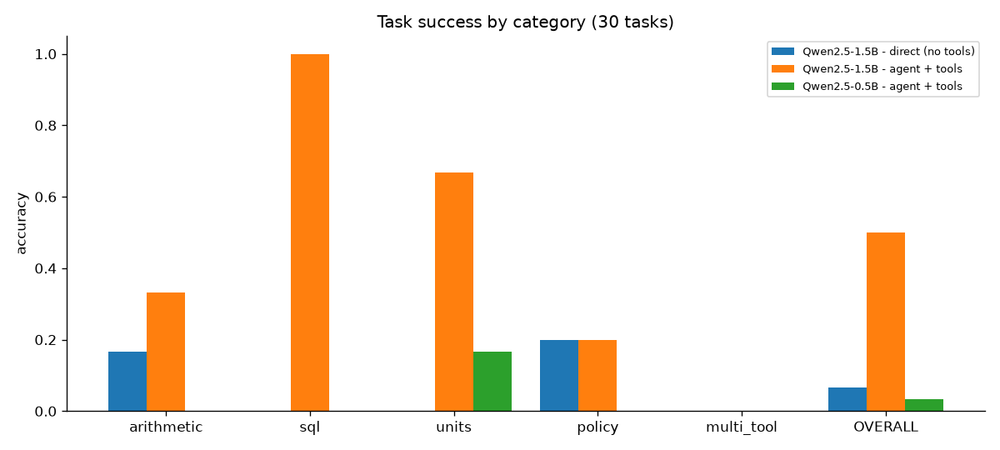
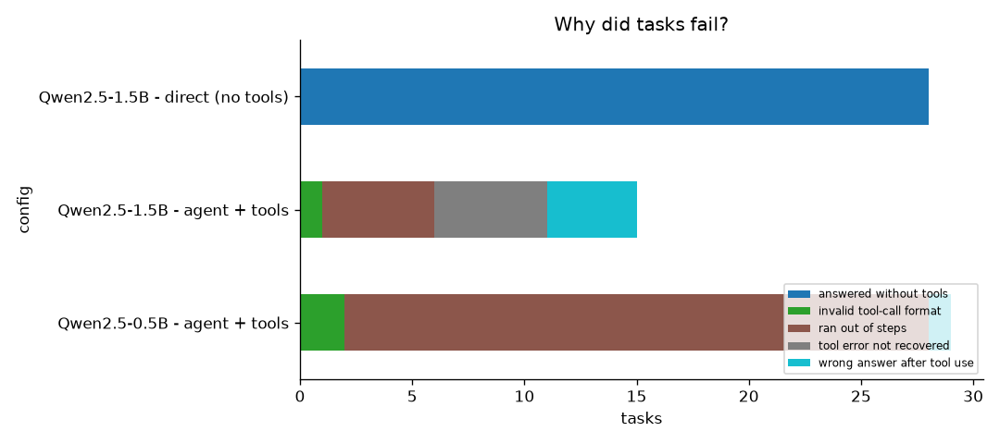

# LLM Agent + Evaluation Harness


 

A from-scratch **tool-using LLM agent** and — more importantly — an **automated evaluation harness** that
measures whether the agent actually works: accuracy per task type, tool-call validity, steps taken and a
breakdown of *why* each failure happened.

No agent framework: the ReAct loop, JSON tool-calling protocol and parser are ~150 readable lines, so every
behaviour can be inspected and tested.

## The agent's tools
| Tool | What it does | Safety |
|---|---|---|
| `calculator` | Arithmetic expressions | AST-whitelisted evaluator — no `eval`, no imports, capped exponents |
| `sql_query` | Queries a seeded shop database (60 customers, 20 products, 500 orders) | Read-only: SELECT/WITH only, writes rejected |
| `convert_units` | Length, mass, volume, temperature, GBP/USD/EUR | Validates units and dimensions |
| `search_policies` | Keyword retrieval over a company policy handbook | — |

## The evaluation suite
**30 tasks in 5 categories** (arithmetic, SQL, unit conversion, policy lookup, multi-tool chains). Expected
answers are **computed from the same database the agent queries**, so the ground truth is correct by construction,
and answers are checked programmatically (numeric tolerance or pattern match) — no LLM-as-judge needed.

## Results (open-weights models, CPU, greedy decoding)

| Configuration | Overall | Arithmetic | SQL | Units | Policy | Multi-tool | Invalid replies | Avg steps |
|---|---|---|---|---|---|---|---|---|
| Qwen2.5-1.5B — direct answer, no tools | 6.7% | 17% | 0% | 0% | 20% | 0% | — | 1.0 |
| **Qwen2.5-1.5B — agent + tools** | **50.0%** | 33% | **100%** | 67% | 20% | 0% | 12.9% | 3.1 |
| Qwen2.5-0.5B — agent + tools | 3.3% | 0% | 0% | 17% | 0% | 0% | **70.1%** | 5.6 |



### Key findings
1. **Tools turn a 1.5B model from useless to useful: 6.7% → 50% task success (7.5×).** Without tools the model
   cannot know the data and gets large-number arithmetic wrong; with tools it answers **every SQL question correctly**.
2. **There is a capability floor for agents.** The 0.5B model understands the tasks but can't follow the
   tool-calling protocol — **70% of its replies are malformed** and 26/30 tasks run out of steps. Instruction-following
   reliability, not knowledge, is the bottleneck at this size.
3. **The harness pinpoints *why* the agent fails** (1.5B model, 15 failures):
   - **Wrong tool choice** — for policy questions it queried the *database* instead of `search_policies`, then
     concluded "insufficient information".
   - **SQL logic slips** — on multi-tool tasks it wrote a `GROUP BY` that returned many rows and took only the first,
     converting £1.4k instead of the £27k total.
   - **Tool errors not recovered** (5 tasks) — e.g. referencing `products.price` without a JOIN, then looping on syntax errors.
   - **Doing maths in its head** despite the instruction not to (compound interest: £13,986 vs correct £16,672).

   Each of these points to a concrete fix: better tool descriptions/routing, a schema-aware SQL prompt, and
   few-shot examples of error recovery — which is exactly what an eval harness is for.



Every step of every run (model output, tool call, observation, error) is saved to
[`reports/traces.jsonl`](reports/traces.jsonl) for inspection.

## Run it
```bash
pip install torch --index-url https://download.pytorch.org/whl/cpu
pip install -r requirements-dev.txt && pip install -e .
pytest -q                                   # 14 deterministic tests (scripted LLM, no downloads)
python -m agentkit.harness --smoke          # whole pipeline in seconds
python -m agentkit.harness                  # Qwen 0.5B + 1.5B on CPU (~1.5 h)
ANTHROPIC_API_KEY=... python -m agentkit.harness --backend anthropic --out reports/claude
```
Add `ANTHROPIC_API_KEY` as a repository secret and the `Evaluate agents` workflow also benchmarks Claude.

## Structure
```
src/agentkit/
├── tools.py     # calculator (AST sandbox), read-only SQL, unit conversion, policy search
├── llm.py       # backends: local Hugging Face model, Anthropic API, scripted (tests)
├── agent.py     # ReAct loop, robust JSON parser, error feedback, traces
├── tasks.py     # 30 tasks with ground truth computed from the database
└── harness.py   # runs configs, metrics, failure taxonomy, figures
```
